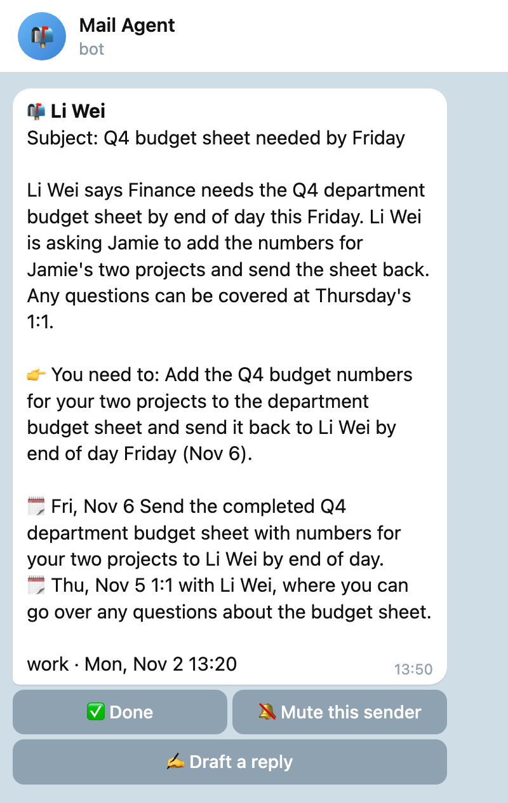
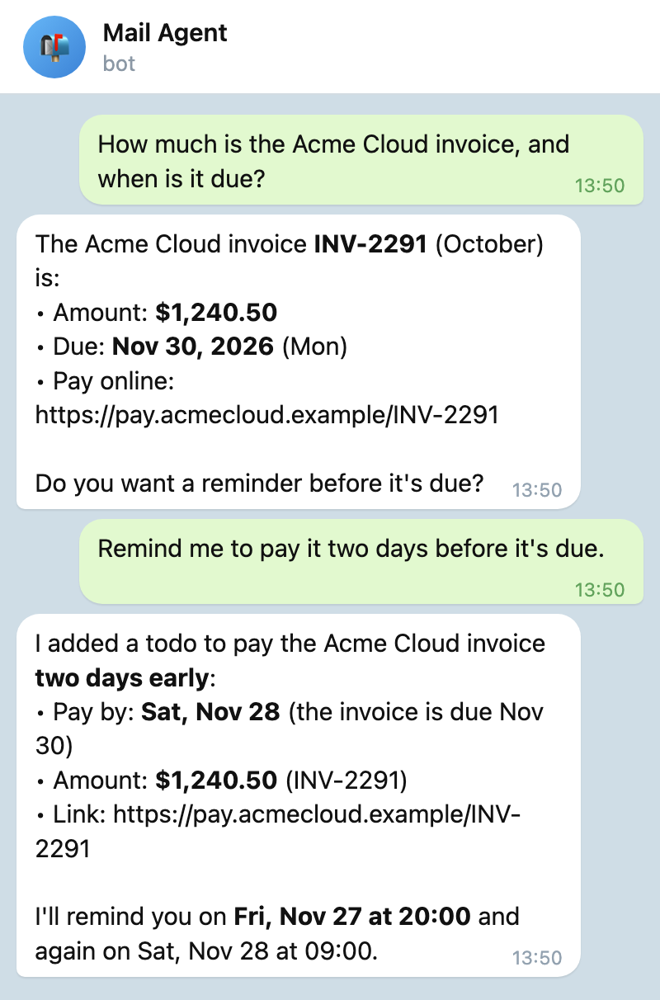
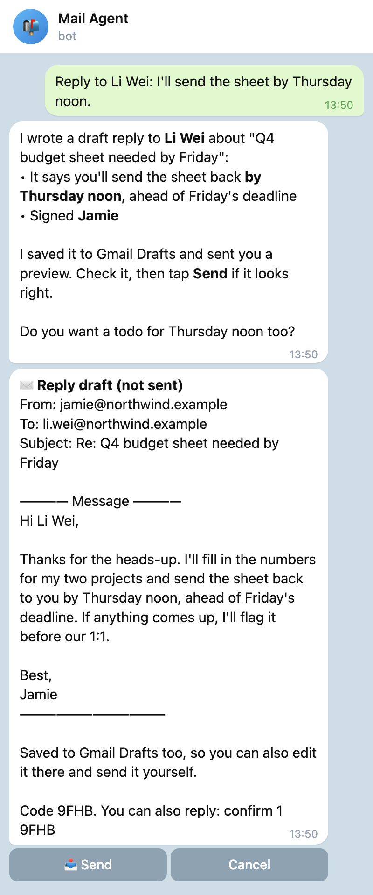
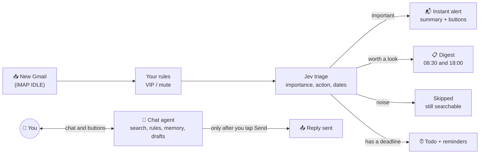
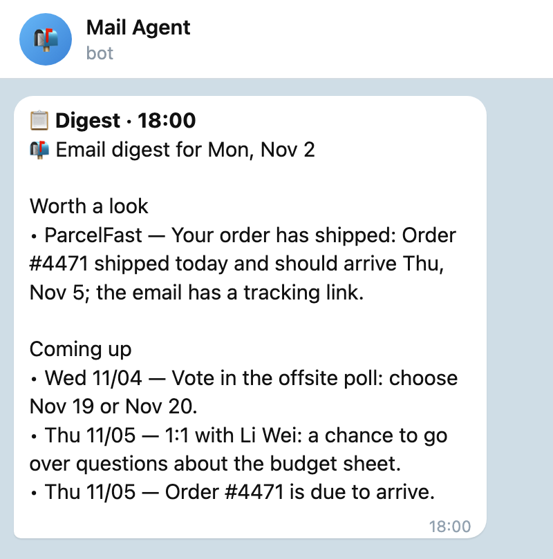
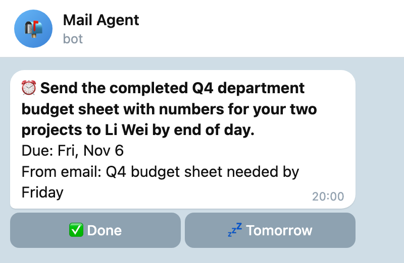

# mail-agent

[](https://github.com/Jaydccq/mail-agent/actions/workflows/ci.yml)
[](LICENSE)


**Your Gmail, sorted for you, in your chat app.** Important mail reaches Telegram or Lark/Feishu within seconds, with a summary and what you need to do. Mail worth a look waits for a digest twice a day, and promotions stay out of your way. Deadlines become todos with reminders. Ask about your mail in plain words and let it draft replies. **Nothing is sent until you tap Send.**

It runs on your own Mac or Linux machine as one Python process with one SQLite file: no server, no public address, no Google Cloud project, no Docker.

<table>
<tr>
<td width="33%" valign="top"><br><b>Important mail, right away</b><br>A summary, what you need to do, the dates, and one-tap buttons.</td>
<td width="33%" valign="top"><br><b>Ask about your mail</b><br>It searches Gmail, reads the email and answers; todos in plain words.</td>
<td width="33%" valign="top"><br><b>Replies you approve</b><br>You see the exact draft; it goes out only when you tap Send.</td>
</tr>
</table>

<sub>Screenshots come from made-up sample emails run through the real code (Jev triage, the message templates and Claude's actual replies), drawn the way Telegram shows them; Lark/Feishu shows the same messages as cards. To regenerate them: <a href="docs/images/make_screenshots.py">docs/images/make_screenshots.py</a>.</sub>

## How it works



1. **Watch.** It keeps an IMAP IDLE connection to each Gmail inbox, so new mail arrives within seconds. It never marks mail read, deletes it or changes labels.
2. **Sort.** Your rules come first (VIP always alerts, mute sends a sender to the digest), then [Jev](https://docs.typesafe.ai) scores the email: how important, whether it needs action, whether it has a date.
3. **Read.** For important mail and mail with a task or date, your generative model writes the summary and pulls out what to do and when. That can be the Claude, Codex or Gemini CLI you're already logged into (your own subscription), or an API such as DeepSeek, Doubao, OpenAI or a local Ollama.
4. **Tell you.** An instant alert (held during quiet hours, 23:00–08:00), a digest at 08:30 and 18:00, and reminders before deadlines.
5. **Talk.** Chat with it to search mail, manage todos, rules and memories, or draft a reply. Sending always waits for your tap.

## Quick start

**1. Get these ready** (about 15 minutes; step by step in the [setup guide](docs/setup.md)):

- a [Gmail app password](docs/setup.md#2-gmail-app-password) (needs 2-Step Verification)
- a [Telegram bot token](docs/setup.md#telegram) from @BotFather, or a [Lark / Feishu app](docs/setup.md#lark--feishu)
- a [Jev API key](docs/setup.md#4-jev-api-key)
- optional: a [generative model](docs/setup.md#5-a-generative-model-optional), for example a logged-in `claude` or `codex` CLI

**2. Install.** The installer brings its own Python through [uv](https://docs.astral.sh/uv/) if you have it, otherwise uses pipx or your Python 3.11+.

```bash
git clone https://github.com/Jaydccq/mail-agent.git
cd mail-agent
./install.sh
```

**3. Answer the wizard.** Five steps, each checked on the spot: Jev key → Gmail address and app password → Telegram or Lark/Feishu, then pairing → model → time zone. It then installs a background service that starts at login.

**4. Check it.**

```bash
mail-agent doctor        # ✅ / ❌ for config, Jev, each mailbox, the chat channel, the model, the service
mail-agent test-notify   # sends you a test message
```

Then send your bot `/help`. To upgrade later: `git pull && ./install.sh`.

## Everyday use

<table>
<tr>
<td width="50%" valign="top"><br><b>Digest</b> at 08:30 and 18:00: what's worth a look, and what's coming up in the next 3 days.</td>
<td width="50%" valign="top"><br><b>Reminders</b> the evening before a deadline and again on the day, with Done and Tomorrow buttons.</td>
</tr>
</table>

- **Buttons on alerts:** ✅ Done · 🔕 Mute this sender · ✍️ Draft a reply
- **Just ask:** "find last week's email from Alex about the contract", "any unread mail from Google this week?", "remind me to file expenses on Friday", "stop alerting me about deals@shop.example", "remember: I reply to work email in English". Any language works, and it handles ordinary questions too.
- **Commands:** `/todo` `/digest` `/status` `/pause` `/resume` `/rules` `/memory` `/mailboxes` `/addmailbox` `/removemailbox` `/timezone` `/new` `/help`
- **Memory:** it uses what you ask it to remember when sorting mail and drafting replies, and now and then suggests something to remember; nothing is saved until you tap Save.

Everything else, including all commands and where data lives: [docs/usage.md](docs/usage.md).

## Safety and privacy

- **It never sends mail on its own.** A reply goes out only when you tap 📤 Send or reply with its one-time code. The code expires after 24 hours, and any change to the draft needs a new confirmation. An interrupted send is reported as unknown and never retried automatically.
- **Email is treated as data, not instructions.** The model that reads mail has no tools, so "forward this to…" inside an email does nothing. In chat, once a request has read email content, changes to rules, memories or todos wait for your Confirm tap.
- **Only you.** It answers only the private chat it was paired with; groups and other people are ignored.
- **What leaves your machine:**
  - **Jev** receives each new email: sender, subject, date, labels, attachment names, up to 6,000 characters of the body and 1,500 of quoted text, plus up to 1,000 characters of your memories.
  - **Your model** receives the emails it summarizes or reads for you, your memories, and your chat messages.
  - **Telegram or Lark** carries the messages it sends you.

  Mail, todos and memories are stored locally in `~/.mail-agent` (an encrypted disk is recommended). Secrets stay in `config.toml` (mode 0600) and are never logged.
- **Model CLIs run locked down:** tools off, an empty temporary directory, and only the environment variables they need. Codex MCP servers you configured yourself can't be turned off from the command line, and turning tools off in the Gemini CLI is best effort.

## Known limits

- Only the inbox is watched, not other labels. Attachments are known by file name; their content isn't read.
- Mail that arrived before you installed it (or before you added a mailbox) isn't back-filled, though chat search covers your whole mailbox.
- The machine has to be on. While a laptop sleeps nothing arrives, and it catches up after waking.
- Built for Gmail and Google Workspace, signing in with an app password. Workspace domains where the admin disabled app passwords, and accounts with Advanced Protection, can't use it.

## Docs

- [Setup guide](docs/setup.md): each prerequisite step by step, the wizard, upgrading, uninstalling, troubleshooting
- [Everyday use](docs/usage.md): alerts, digests, todos, chat, replies, memory, every command, data and config
- [Testing](docs/testing.md): running the tests, the live chat eval, and what has been tested for real
- [Contracts](CONTRACTS.md): module interfaces, for contributors

## License

Apache-2.0. See [LICENSE](LICENSE).
