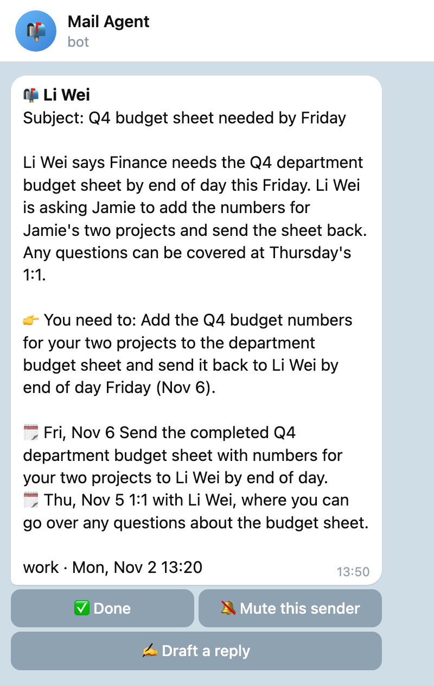
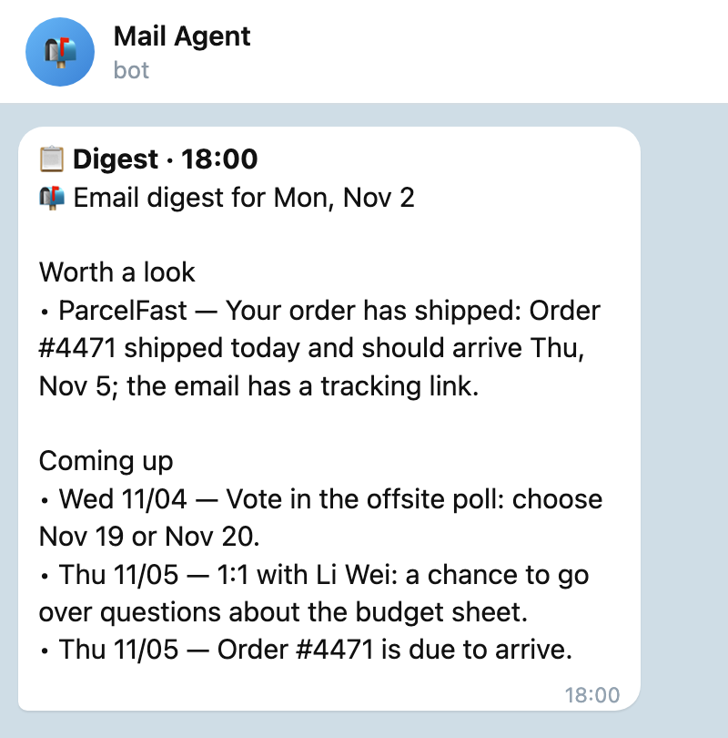
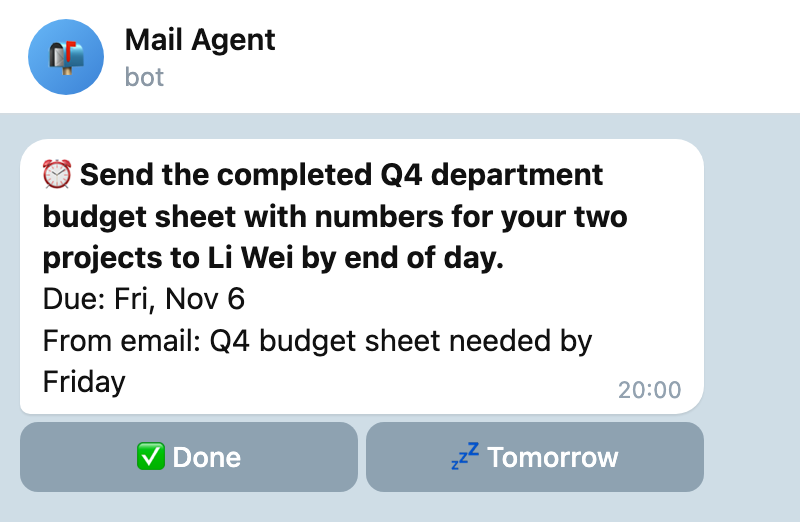
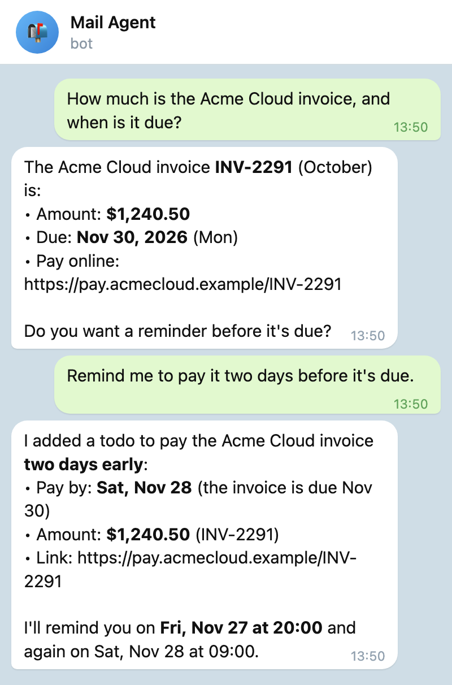
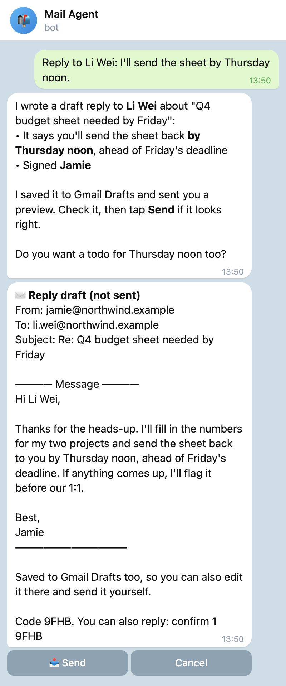

# Everyday use

- [Notifications](#notifications)
- [Digest](#digest)
- [Todos and reminders](#todos-and-reminders)
- [Talking to it](#talking-to-it)
- [Replying to mail](#replying-to-mail)
- [Memory](#memory)
- [Chat commands](#chat-commands)
- [Terminal commands](#terminal-commands)
- [Data and config](#data-and-config)

## Notifications



Important mail arrives as a card: sender, subject, a 2–3 sentence summary, what you need to do, and the dates in it. Buttons:

- **✅ Done**: handled, no more nudges about it
- **🔕 Mute this sender**: from now on their mail goes to the digest only (undo with `/rules`)
- **✍️ Draft a reply**: see [Replying to mail](#replying-to-mail)

What counts as important: mail Jev scores high, mail that needs action from you, security alerts, and anything matching a VIP rule. A mute rule moves a sender to the digest. Unimportant mail (promotions, newsletters) is neither pushed nor put in the digest, but stays searchable.

**Quiet hours** (23:00–08:00 by default): nothing is pushed instantly; it's held until morning. VIP mail still comes through. `/pause` stops instant alerts entirely (everything goes to the digest) until `/resume`.

<br clear="right">

## Digest



At 08:30 and 18:00 by default, mail worth knowing about but not urgent is rolled up: what needs you, what's worth a look, and todos due in the next 3 days. Skipped mail (most promotions and newsletters) isn't included. It also says plainly when there was simply no new mail or a mailbox failed to sync. `/digest` sends one right away.

<br clear="right">

## Todos and reminders



Deadlines and meetings in emails become todos automatically. Reminders:

- with a time: 20:00 the evening before, and 2 hours before
- date only: 20:00 the evening before, and 09:00 on the day

Each reminder has **✅ Done** and **💤 Tomorrow**. If you reply to a thread yourself in Gmail, its "reply needed" todo closes by itself. `/todo` lists open todos; in chat you can add, complete or snooze them in plain words.

<br clear="right">

## Talking to it



Needs a generative model. Write the way you'd write to an assistant, in any language:

- Find last week's email from Alex about the contract
- What did I get in the last 3 days? Anything I need to reply to?
- How much is the Acme invoice, and when is it due? Remind me two days before.
- Any unread mail from Google this week?
- Don't send me instant alerts for mail from deals@shop.example anymore
- Remember: I always reply to work email in English
- Help me write a polite note to my landlord about the heater

It searches all of Gmail (not just what arrived since install), reads emails, manages todos and rules, and remembers what you ask it to. It also answers ordinary questions and writes text for you in the chat. Replies show **bold**, *italics*, `code` and lists; a table becomes a list and a link shows its full address.

<br clear="right">

## Replying to mail



Tap **✍️ Draft a reply** on a notification, or ask in chat ("reply to Li Wei: I'll send it by Thursday"). You get the full draft, character for character what would be sent, and a copy is saved to your Gmail Drafts so you can also edit it there.

**Nothing is sent until you tap 📤 Send** or reply `confirm <id> <code>`. The code works once and expires after 24 hours; if the draft changes, you confirm again. Ask for changes ("shorter, and say I'll book the table") and you get a new draft. After sending, the copy in Gmail Drafts goes to Trash, and the sent reply isn't reported back to you as new mail. If a send is interrupted and the outcome is unclear, you're told to check Gmail's Sent folder; it's never re-sent automatically.

It can only reply to mail you received. It doesn't write new emails to arbitrary addresses, and it can't change your settings; it points you to the command instead.

<br clear="right">

## Memory

Things you ask it to remember ("remember: my manager is Priya") are saved right away and used when sorting your mail and drafting replies. Once in a while it notices something itself and asks first, with **💾 Save** / **No** buttons; nothing is saved until you tap Save, and anything you turn down is never suggested again (at most about one suggestion a day). It notices:

- a fact you mention in passing ("I'm a PhD student", "my manager is Priya")
- a sender, or several people at one organization, whose alerts you keep marking ✅ Done without replying, or several senders at one organization you've muted
- a reply it drafted that you edited in Gmail before sending: a changed sign-off, or a clear change in tone or length

`/memory` lists memories and `/memory del <id>` removes one.

## Chat commands

| Command | What it does |
|---|---|
| `/todo` | open todos, with Done / Tomorrow buttons |
| `/digest` | send a digest now |
| `/status` | how things are running |
| `/pause` · `/resume` | stop / restart instant alerts (mail still goes to the digest) |
| `/rules` | list rules; `/rules del 3` removes #3 |
| `/memory` | list memories; `/memory del 3` removes #3 |
| `/mailboxes` | your mailboxes and their sync status |
| `/addmailbox you@gmail.com <app password>` | add a mailbox or update its app password. The bot deletes your message right away (it contains the password), checks the login and starts watching, no restart |
| `/removemailbox <address or id>` | stop watching a mailbox (mail already stored stays) |
| `/timezone [zone]` | show or change the time zone, e.g. `/timezone Asia/Shanghai` or `/timezone new york` |
| `/new` | start a new conversation |
| `/help` | all of the above |

Changing the time zone moves digests, quiet hours and reminders right away, and open todos move with it: a timed one keeps its moment (12:00 in Los Angeles becomes 04:00 the next day in Shanghai), a date-only one keeps its date.

## Terminal commands

```text
mail-agent setup                          reconfigure (Enter keeps current values)
mail-agent run                            run in the foreground
mail-agent status                         config (secrets hidden) + runtime stats + background service state
mail-agent doctor                         check config, SQLite, Jev, each mailbox, channels, generative model
mail-agent add-mailbox [ADDRESS]          add a mailbox, or update an existing one's app password
mail-agent remove-mailbox ADDRESS_OR_ID   stop watching a mailbox (stored mail stays in the local db)
mail-agent mailboxes                      list mailboxes and their sync status
mail-agent timezone [ZONE]                show or change your time zone (restarts the background service)
mail-agent model                          choose the generative model (CLI subscription, Doubao, other APIs, your own URL)
mail-agent restart                        restart the background service (e.g. after editing config.toml)
mail-agent test-notify                    send yourself a test message
mail-agent install-service                install the background service (Linux systemd --user / macOS launchd)
mail-agent uninstall-service
```

`add-mailbox` asks for the address (if not given) and the app password, verifies the IMAP login, saves the config, and restarts the background service if it's installed. A new mailbox is watched from that moment on: older mail isn't back-filled, but search in chat still covers its full history.

## Data and config

Everything lives in `~/.mail-agent/` (set `MAIL_AGENT_HOME` to move it):

- `config.toml`: settings including secrets, permissions 0600. Time zone, language, digest times and quiet hours are under `[prefs]`; after editing by hand run `mail-agent restart`
- `agent.db`: SQLite with email bodies, todos, rules, memory and conversations. Emails, todos, rules and memory are kept; delivered notifications and other bookkeeping are removed after 30 days, chat history after 90 days
- `agent.log`: rotating log; never records secrets or email bodies

`prefs.language` (default `en`) sets the language of notifications, digests and summaries. Chat replies follow the language you write in. Only one instance runs at a time: a second process refuses to start.
